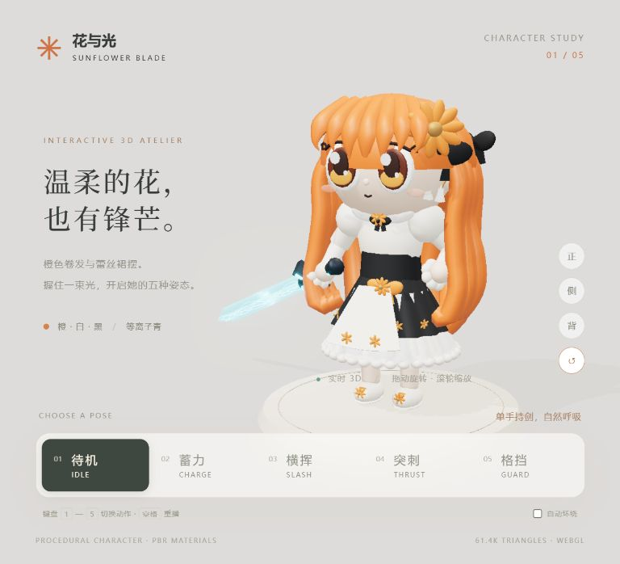

# 花与光 · Sunflower Blade

本地 Three.js 实时 3D 项目。根据提供的三视图程序化拼装 Q 版角色，不使用在线模型或生成式 API。

## 运行

需要 Node.js 20.19+ 或 22+。在此目录执行：

```sh
npm install
npm run dev
```

打开终端显示的本机地址。不要双击 index.html：ES Modules 和本地依赖需要 HTTP 服务。

## 操作

- 下方按钮或键盘 1–5：待机、蓄力、横挥、突刺、格挡。
- 空格：重播当前动作（横挥为一次扫击，结束后保留收势）。
- 拖动：OrbitControls 环绕；滚轮：缩放。
- 右侧正 / 侧 / 背：三视图；↺ 恢复初始视角。
- 自动环绕：慢速旋转相机。

## 文件结构

| 文件 | 职责 |
|---|---|
| src/config.js | 色板、角色尺寸、剑长、辉光参数、动作文案 |
| src/geometry.js | 基础几何、花朵、蝴蝶结、褶裙 |
| src/character.js | 角色装配、PBR 材质、分层挂点、双臂简易 IK |
| src/sword.js | 等离子外刃、内核、流动纹理、电弧、世界坐标拖尾 |
| src/animation.js | 五个动作、Quaternion 插值、双手握点跟随 |
| src/main.js | 场景、三点光、环境光、阴影、OrbitControls、Bloom、交互 |
| src/style.css | 响应式界面 |

## 建模与参数

角色约 2.6 头身。橙色长发以粗发片与 CatmullRom 曲线构造，保留额前刘海、两侧长发及背部大波浪；太阳花、黑色蝴蝶结与白色流苏有实体厚度。裙装分成白色内裙、黑色外裙、白色前围裙、腰封、蕾丝环与花纹。面部用压扁球体、曲线、琥珀虹膜和高光表现。

使用 Group/Object3D 挂点，**不是蒙皮骨骼模型**。包含头、躯干、双臂、肘、双腿与 `hand-socket`。剑为右手挂点子对象，双手动作的左手跟随剑柄握点；两段 IK 在高举时会适度伸展，属于 Q 版表现性动画。当前项目不包含 glTF 导出器。

头发和金属使用 MeshStandardMaterial；布料具有程序化织物 bump；蕾丝半透明。能量剑采用 MeshPhysicalMaterial 半透明外刃、自发光核心、动态曲线能量和 LineSegments 电弧，UnrealBloomPass 提供辉光。剑总长约角色身高 79%。

控制几何细分并复用球体；右下角显示实际角色和剑的三角面数量。复杂花饰和蕾丝含较多独立网格，后续用于大型游戏时可按需求合并网格或烘焙纹理。

## 手动验收

按用户约束，不附自动测试任务。请自行检查：

1. 启动页面后角色、地面阴影与发光剑可见。
2. 正 / 侧 / 背视角核对参考轮廓，尤其长发、发饰背面与裙摆。
3. 点击五个动作；双手握点是否合理，横挥是否有拖尾，突刺是否朝 +Z。
4. 空格重播横挥；键盘 1–5 和按钮状态是否一致。
5. 缩放、旋转、自动环绕及窄屏布局。

这是基础几何程序化风格化重建；与参考的逐像素/逐轮廓一致性仍需人工审阅，不能作为手工精修模型验收结论。

## 预览



严格贴合度及动态操作仍需用户手动验收；未运行自动测试。

